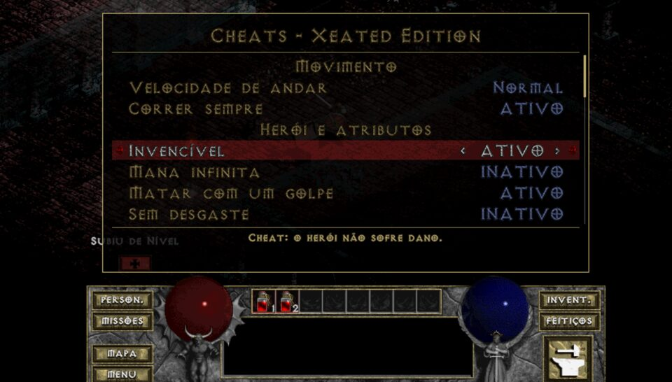
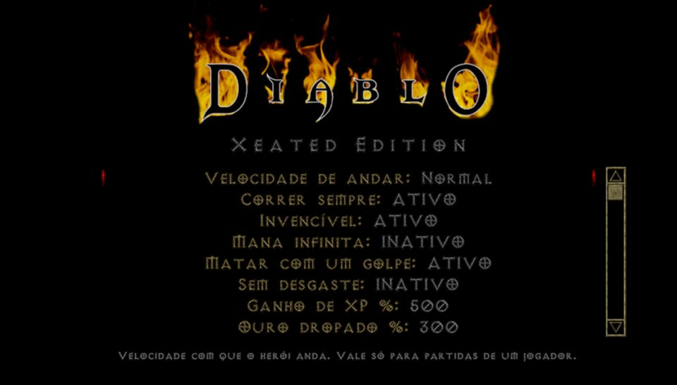

# DevilutionX – Xeated Edition

Fork do [DevilutionX](https://github.com/diasurgical/devilutionX) **1.5.5** (Diablo e Hellfire) feito para o
**Nintendo Switch desbloqueado** (homebrew `.nro`). Acrescenta velocidade de andar ajustável, corrida
liberada o tempo todo e um menu de cheats completo dentro do jogo.

No Diablo original só dá para correr na cidade (e só no Hellfire). Na masmorra o herói anda devagar o
tempo todo, mesmo com o mapa vazio. Aqui você escolhe.



## O que esta edição adiciona

### Movimento

| Opção | Valores | Efeito |
| --- | --- | --- |
| Velocidade de andar | Normal, Rápido (1,3x), Corrida (2x), Muito rápido (2,7x), Turbo (4x) | Ticks de jogo por tile: 8, 6, 4, 3 e 2 |
| Correr sempre | Ligado/Desligado | Usa no mínimo a velocidade de corrida (2x) na cidade e na masmorra, mesmo com monstros por perto |

A simulação continua a 20 ticks por segundo, igual ao original. A velocidade maior só pula quadros da
animação de andar, do mesmo jeito que a corrida da cidade do Hellfire. O desenho continua interpolado na
taxa da tela, então o jogo segue a 60 fps.

### Cheats

Ficam em **Menu do jogo → Cheats** (Start + Select no controle) e também em
**Configurações → Xeated Edition** no menu principal. Os valores ficam salvos no `diablo.ini`.

| Grupo | Item | Tipo |
| --- | --- | --- |
| Herói e atributos | Invencível | liga/desliga: não sofre dano nem fica atordoado |
| | Mana infinita | liga/desliga: magias não gastam mana (e podem ser lançadas mesmo custando mais que a mana máxima) |
| | Matar com um golpe | liga/desliga: todo ataque (corpo a corpo, flecha ou magia) acerta e mata |
| | Sem desgaste | liga/desliga: armas, escudos e armaduras não perdem durabilidade |
| | Restaurar vida e mana | ação |
| | Subir 1 nível / Subir 10 níveis | ação (com os pontos de atributo do nível) |
| | +5 pontos de atributo | ação (distribua no painel do personagem) |
| | Atributos no máximo | ação |
| Magias | Aprender todas as magias | ação (todas as disponíveis no jogo atual) |
| | Todas as magias +1 nível / no nível 15 | ação |
| Ouro, experiência e drops | Ganho de XP % | 100, 150, 200, 300, 500, 1000, 2000 |
| | Ouro dropado % | 100, 200, 300, 500, 1000 (cada pilha guarda no máximo 5000) |
| | Chance de drop % | 100, 150, 200, 300, 500, 1000 (acima de 100% podem cair vários itens por monstro) |
| | Raridade dos drops | Normal, Mágico ou melhor, Únicos frequentes |
| | Bônus de nível do item | +0, +5, +10, +15, +20, +30 (atributos mágicos melhores) |
| | +10.000 / +100.000 de ouro | ação (o que não cabe no inventário vai para o baú) |
| Itens e mundo | Identificar todos os itens | ação (equipados, inventário e cinto) |
| | Reparar todos os itens | ação |
| | Revelar mapa | ação (automapa do nível atual) |
| | Viajar para o nível | ação (1 a 16 no Diablo, 1 a 24 no Hellfire, 1 a 2 no shareware) |

**Tudo isso só vale em partidas de um jogador.** No multijogador o jogo se comporta exatamente como o
DevilutionX 1.5.5 oficial (mesma versão de protocolo, dá para jogar com quem usa o oficial). Os cheats
também ficam desligados durante a gravação ou reprodução de demos.

Os drops "trapaceados" usam só valores que o jogo já guarda no item (nível do item e as marcas de
qualidade), então os itens são recriados iguais ao carregar o save ou o herói.

### Outras mudanças

- O idioma do jogo agora segue o idioma do sistema do Switch (antes ficava sempre em inglês). Todo o
  texto novo tem tradução para português do Brasil.
- O menu do jogo ajusta o espaçamento dos itens quando não cabem acima do painel (necessário por causa do
  item novo "Cheats").
- O nome do homebrew no menu do Switch é "DevilutionX Xeated Edition", e a versão aparece no menu principal
  como `DevilutionX v1.5.5 Xeated Edition 1.0.0`.

## Instalação no Switch

1. Copie `devilutionx.nro` para `/switch/devilutionx/` no cartão SD. Pode substituir o `.nro` oficial: a
   pasta, os saves e o `diablo.ini` são os mesmos.
2. Copie `DIABDAT.MPQ` do CD ou da instalação do GOG para a mesma pasta. Sem ele, use o `spawn.mpq` do
   [shareware](https://github.com/diasurgical/devilutionx-assets/releases/download/v2/spawn.mpq).
3. Para o Hellfire: `hellfire.mpq`, `hfmonk.mpq`, `hfmusic.mpq` e `hfvoice.mpq`.
4. Abra pelo Homebrew Menu segurando **R** sobre um jogo instalado (modo título, não pelo álbum).

Controles: os mesmos do DevilutionX (veja `Packaging/switch/README.txt`). Para os cheats:
**Start + Select** abre o menu do jogo, depois **Cheats**. No menu de cheats: direcional cima/baixo escolhe,
esquerda/direita muda o valor, **A** confirma ou executa a ação, **B** volta.

## Compilando

O `.nro` pronto fica nas [releases](https://github.com/aeon1911/DevilutionX-XeatedEdition/releases). Ele é
gerado pelo workflow `Xeated Switch` do GitHub Actions (artefato `devilutionx-xeated.nro`; nas tags `xe-*` o
zip para o SD e o `.nro` são anexados à release). Este fork só mantém o build do Switch; o código das outras
plataformas continua no repositório porque o build de Linux é usado nos testes. Para compilar localmente com Docker:

```sh
docker run --rm -v "$PWD":/src -w /src devkitpro/devkita64:latest bash -c '
  apt-get update && apt-get install -y --no-install-recommends gettext &&
  cmake -S . -B build-switch -DCMAKE_BUILD_TYPE=RelWithDebInfo -DCMAKE_TOOLCHAIN_FILE=/opt/devkitpro/cmake/Switch.cmake &&
  cmake --build build-switch -j"$(nproc)"'
# resultado: build-switch/devilutionx.nro
```

Testes (Linux): `cmake -S . -B build -DBUILD_TESTING=ON && cmake --build build -j && (cd build && ctest)`.
Os testes da edição ficam em `test/xeated_test.cpp`.

## Como foi testado

- Os 213 testes do DevilutionX 1.5.5, mais 15 testes novos da edição: 228/228 passando.
- `.nro` rodando no emulador Ryujinx 1.3.3 com o `spawn.mpq`: menu de cheats, todos os valores e ações,
  velocidade medida pelo deslocamento da tela (Corrida = 2x, Turbo = 4x, Correr sempre = 2x), invencível,
  matar com um golpe, XP 500%, drops mágicos, identificar e reparar, revelar mapa, viagem para o nível,
  mana infinita lançando magia mais cara que a mana máxima, salvar e carregar com os itens gerados, idioma
  pt-BR automático e menus a ~60 fps.
- Testado num Switch físico com o jogo original (`DIABDAT.MPQ`). O Hellfire ainda não foi testado no console.



## Créditos e licença

Todo o mérito do motor é do [time do DevilutionX](https://github.com/diasurgical/devilutionX/graphs/contributors).
O README original está em [docs/README-upstream.md](docs/README-upstream.md).

DevilutionX é distribuído sob a licença Sustainable Use (veja `LICENSE.md`): uso não comercial. Esta
edição herda a mesma licença. Diablo® e Hellfire® são marcas da Blizzard Entertainment; este projeto não
tem ligação com a Blizzard e não distribui dados do jogo.
